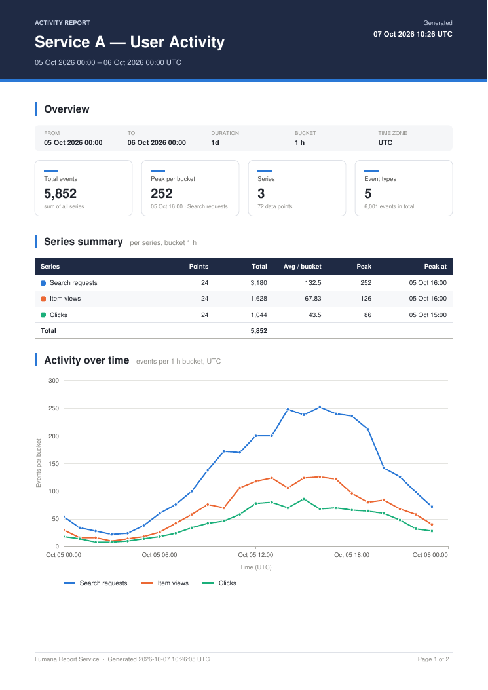

# report-service (Go, gRPC)

Renders PDF activity reports from time-series data. Service B (NestJS) collects
the data from RedisTimeSeries and calls `report.ReportService/GenerateReport`.
This service returns the PDF bytes and a suggested file name.

Contract: [`../proto/report.proto`](../proto/report.proto). This service does not edit that file.



Sample output: [`docs/sample-report.pdf`](docs/sample-report.pdf) and the
empty-period variant [`docs/sample-report-empty.pdf`](docs/sample-report-empty.pdf).

## What the report contains (A4 portrait)

1. **Title band**: title, period, and the generation timestamp.
2. **Overview**: a period strip (from, to, duration, bucket, time zone) and KPI cards.
   The cards show total events (sum of all series values), the peak value per bucket
   with its time and series, the series count with the number of data points, and
   the number of event types with their total.
3. **Series summary**: one table row per series, with points, total, average per
   bucket, peak and peak time, plus a totals row. A colour swatch links each row to
   its line on the chart.
4. **Activity over time**: a multi-series line chart drawn as vector graphics. It has
   "nice" y ticks, time ticks aligned to calendar steps (5 min, 1 h, 6 h, 1 day…),
   axis titles and a legend that wraps onto more lines when needed. Up to 8 series
   get their own colour from a fixed palette that is checked for colour-blind
   readers. When there are more series, the largest 7 keep their own lines and the
   rest are added together into a grey "Other (n series)" line, so colours are never
   reused.
5. **Events by type**: a horizontal bar chart of `log_summary`, sorted by count. It
   shows at most 15 bars and folds the rest into "Other". A full table follows, with
   count and share for every type, plus a total row.
6. **Running header** on later pages (title and period) and a **footer** on every
   page with the generation timestamp and "Page X of Y". Tables that run onto a new
   page repeat their header row.

Empty input still produces a valid report: the KPIs show 0 or "–", and each
section shows a "No data for period" box.

## Layout

```
cmd/server         gRPC server: env config, health, reflection, graceful shutdown
cmd/sampleclient   sends synthetic data and writes the PDF (manual end-to-end check)
internal/server    handler, request validation (→ codes.InvalidArgument), interceptors
internal/report    domain model, KPI calculation, PDF builder (go-pdf/fpdf)
internal/chart     vector line and bar charts drawn with fpdf primitives, tick maths
gen/reportpb       generated protobuf/gRPC code (committed)
scripts/gen-proto.sh  regenerates gen/reportpb using Docker only
```

The only dependencies are `github.com/go-pdf/fpdf` and gRPC/protobuf. Charts are
drawn directly as PDF vector paths, with no raster images and no headless browser.
They stay sharp at any zoom, and a typical report is about 16 KB.

## API behaviour

| Condition | gRPC code |
|---|---|
| `from_ms <= 0`, `to_ms <= from_ms`, period longer than 366 days | `INVALID_ARGUMENT` |
| `bucket_ms < 0` or larger than the period (`0` means raw, no bucket) | `INVALID_ARGUMENT` |
| title longer than 200 chars or not valid UTF-8 | `INVALID_ARGUMENT` |
| more than 100 series, 50k points per series, 200k points in total, or 1000 log types | `INVALID_ARGUMENT` |
| a series with neither key nor label; a NaN/Inf value; a timestamp <= 0; a negative count | `INVALID_ARGUMENT` |
| rendering failure (or a panic, caught by the recovery interceptor) | `INTERNAL` |

An empty title becomes "Activity Report". Points do not need to be sorted.
Response `filename` is `report_<from>_<to>.pdf`, for example
`report_20261005T0000Z_20261006T0000Z.pdf`, with both times in UTC.

The server also registers `grpc.health.v1.Health`, which reports `SERVING`
(and `NOT_SERVING` while it shuts down), and server reflection, so `grpcurl`
works without the proto file.

## Configuration

| Env | Default | |
|---|---|---|
| `GRPC_PORT` | `50051` | listen port |
| `REPORT_TIMEZONE` | `UTC` | IANA zone used for every timestamp in the PDF. The zone database is embedded in the binary. |
| `LOG_LEVEL` | `info` | `debug` also logs health-check calls |
| `LOG_FORMAT` | `json` | `json` or `text` (log/slog) |
| `GRPC_MAX_RECV_MB` | `32` | maximum request size |
| `SHUTDOWN_TIMEOUT` | `15s` | how long SIGTERM/SIGINT waits for `GracefulStop` before it forces a stop |

## Run

Every command uses Docker. You do not need Go installed locally.

```bash
# from backend/report-service
docker build -t lumana/report-service:dev .
docker run --rm -p 50051:50051 lumana/report-service:dev

# smoke test with grpcurl
grpcurl -plaintext localhost:50051 list
grpcurl -plaintext -d '{"title":"x","from_ms":"1000","to_ms":"500"}' \
  localhost:50051 report.ReportService/GenerateReport   # -> InvalidArgument
```

The image is `distroless/static:nonroot` and runs as a non-root user. It contains the
server, the sample client and `grpc_health_probe`, which the Docker `HEALTHCHECK`
uses. The health check is exec-form and calls `127.0.0.1:50051`. If you change
`GRPC_PORT`, override the health check too. For example, in docker-compose:
`healthcheck: { test: ["CMD", "/grpc_health_probe", "-addr=127.0.0.1:50051"] }`.

### Generate the sample PDF end to end

```bash
make sample          # build image, start server, run client, write docs/*.pdf
```

Without `make`:

```bash
docker network create report-net
docker run -d --name report-svc --network report-net lumana/report-service:dev
docker run --rm --network report-net -u "$(id -u):$(id -g)" -v "$PWD/docs":/out \
  --entrypoint /sampleclient lumana/report-service:dev \
  -addr report-svc:50051 -out /out/sample-report.pdf      # flags: -empty -hours 168 -series 12
docker rm -f report-svc
```

## Test

```bash
make test            # go test -race ./... inside golang:1.25
make vet
```

The tests cover:

- **`internal/report`**: a PDF with data and without data; series with no points; a
  single point; non-Latin text; pagination with 20 series and 60 types; KPI maths;
  folding into "Other"; duration and filename formatting. Each test checks the
  output starts with `%PDF-` and ends with `%%EOF`.
- **`internal/chart`**: tick generation and number formatting.
- **`internal/server`**: a table-driven test of every validation rule; checks that an
  invalid request returns `InvalidArgument` and never calls the builder; that a
  builder error returns `Internal`; and an in-memory (bufconn) gRPC round trip with
  the real builder and interceptors.

## Regenerate protobuf code

```bash
make proto           # = ./scripts/gen-proto.sh
```

The script runs `golang:1.25` with `../proto` mounted. It downloads protoc 29.3,
installs `protoc-gen-go` v1.36.6 and `protoc-gen-go-grpc` v1.5.1 at pinned
versions, and rewrites `gen/reportpb`. The generated code is committed so that
the Docker build (context `./backend/report-service`) needs nothing outside this
folder. Run the script again whenever `report.proto` changes.

## Limitations

- PDF text uses the built-in Helvetica font with cp1252 encoding. Latin-1 and
  Western European text, plus — – … ·, print correctly. Characters outside cp1252 (Cyrillic,
  CJK…) are printed as `.` placeholders. They do not break the report. Supporting them
  would require embedding a UTF-8 TTF font (`AddUTF8Font`).
- "Total events" is the sum of all series values. This assumes the series hold
  per-bucket counts, which is how Service B aggregates them. "Avg / bucket" divides
  that total by the number of buckets in the whole period, not by the number of
  points returned.
- The whole PDF is built in memory before it is sent. That is fine within the
  request limits above, but there is no streaming.
- Series `labels` are accepted but not printed.
